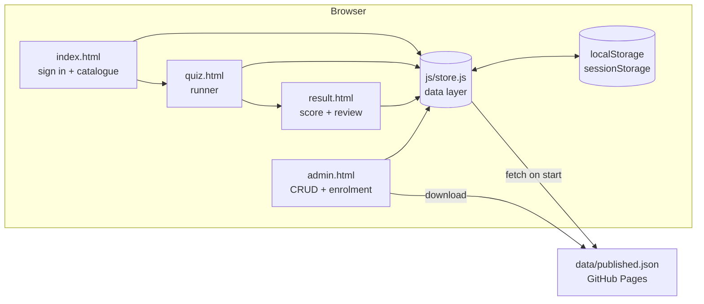
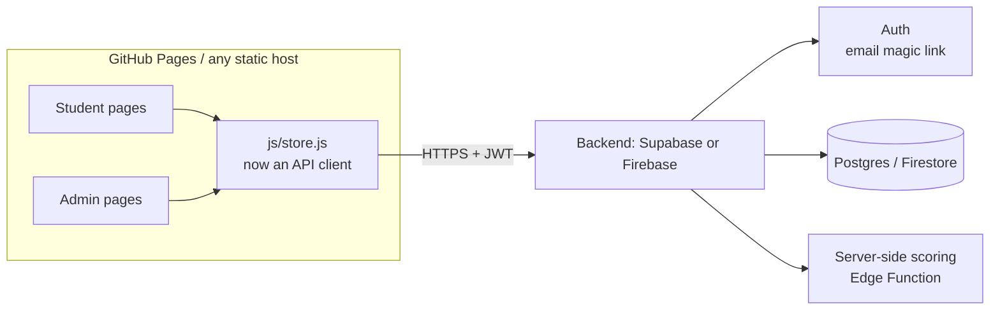

# Architecture

QuizHub is delivered in two phases. **Phase 1** (this repository) meets the project brief with a static site. **Phase 2** is the production design that adds real authentication and a shared database without rewriting the pages.

## 1. Goals

* Admins create and modify quizzes and decide which student emails may attempt each one.
* Students attempt quizzes from any device after proving they are enrolled.
* Timed attempts, auto-submit, progress, scoring, answer review, randomised order and a high-score table.
* Hostable on GitHub Pages.

## 2. Phase 1: static client (this repo)



### Data flow across devices

| Data | Where it lives | Shared across devices? |
| --- | --- | --- |
| Quizzes, questions, enrolled emails | `localStorage` + `data/published.json` in the repo | **Yes**, after the admin publishes |
| Attempts, answers, scores | Cloudflare D1 with `localStorage` cache | Yes |
| High-score table | Cloudflare D1 with `localStorage` cache | Yes |
| In-progress attempt (answers, deadline) | `localStorage` | No, until submission |
| Student / admin session | `sessionStorage` | No |

### Modules

| File | Responsibility |
| --- | --- |
| `js/store.js` | Single gateway to storage. Validation, normalisation, enrolment rules, scoring (`buildAttempt`), leaderboard, backup. Pure functions are unit tested in Node |
| `js/common.js` | Presentation helpers: HTML escaping, toasts, confirm dialog, downloads, score rows |
| `js/index.js` | Sign-in against the enrolment list, quiz catalogue, history, leaderboard |
| `js/quiz.js` | State machine: intro, running, submitted. Timer based on an absolute deadline (`endsAt`), not a counter, so refresh and background tabs stay accurate |
| `js/result.js` | Renders a stored attempt snapshot |
| `js/admin.js` | Quiz and question editor, enrolment list, results, publish, backup, password |

### Key design decisions

* **Attempts are snapshots.** An attempt stores the question text, options and correct index at submission time, so editing a quiz later never changes old results or reviews.
* **Deadline-based timer.** `state.endsAt` is persisted with each answer. A refresh resumes with the true remaining time; if the deadline has passed the attempt is submitted on load.
* **Randomisation** is a Fisher-Yates shuffle of question ids stored in `state.order`, so the order is stable for the whole attempt and across refreshes.
* **Output escaping.** All user-supplied text (quiz titles, questions, names) is escaped before it goes into `innerHTML`. CSV export neutralises spreadsheet formulas (`= + - @`).
* **Allow-list rules.** An entry is either an exact email or `@domain`. Matching uses `endsWith('@domain')`, so `x@evil-campus.edu` does not match `@campus.edu`.

### Known limits of phase 1

1. **No real security.** Quiz answers and the enrolment list are readable by anyone who can load the site. The admin password lives in the browser.
2. **The current sign-in is not strong authentication.** It verifies only the enrolment list, not proof of account ownership.
3. **Quiz answers are visible in browser data.** Correct answers should be moved server-side before high-stakes exams.

These are inherent to a serverless site and are the reason for phase 2.

## 3. Phase 2: production architecture



### Recommended stack

| Concern | Choice | Why |
| --- | --- | --- |
| Hosting | GitHub Pages (unchanged) | Free, already set up |
| Auth | Supabase Auth or Firebase Auth with **email magic links** | Students prove they own the enrolled address; no passwords to manage |
| Database | Supabase Postgres (row-level security) or Firestore (security rules) | Per-student access rules enforced by the database |
| Scoring | Edge Function / Cloud Function | Correct answers never reach the browser during the quiz; scores cannot be forged |

### Data model

```text
profiles      (id, email, role: 'admin' | 'student')
quizzes       (id, title, subject, description, duration_min, pass_mark, shuffle,
               max_attempts, status: draft|published, updated_at)
questions     (id, quiz_id, position, text, options[], correct_index, explanation)
enrolments    (quiz_id, email_or_domain)                    -- the allow-list
attempts      (id, quiz_id, student_id, started_at, deadline, submitted_at,
               score, total, percent, auto_submitted, question_order[])
answers       (attempt_id, question_id, chosen_index)
-- view: high_scores (best attempt per student per quiz, top N)
```

### Access rules (row-level security)

| Table | Student | Admin |
| --- | --- | --- |
| `quizzes` | read published quizzes they are enrolled in | full access |
| `questions` | **no direct read of `correct_index`**; served through a function that omits it | full access |
| `enrolments` | none | full access |
| `attempts`, `answers` | insert/read own rows only | read all |
| `high_scores` | read (names only, no emails) | read |

### Attempt lifecycle (server authoritative)

1. `POST /attempts/start` checks enrolment and `max_attempts`, creates the attempt with a server-side `deadline`, returns the questions (without answers) in random order.
2. `PUT /attempts/:id/answers` saves answers as the student goes (resume on any device).
3. `POST /attempts/:id/submit` (or the deadline passing) scores on the server and returns the review with the correct answers.

### Migration path from phase 1

1. Create the project and tables, import `data/published.json` with a one-off script.
2. Rewrite `js/store.js` to call the API. Its public methods already match the operations above (`quizzesFor`, `buildAttempt`, `addAttempt`, `getScores`, ...). Because calls become asynchronous, controllers add `await` (they already `await Store.init()`).
3. Replace the admin password screen with Supabase/Firebase sign-in and role checks.
4. Add the magic-link sign-in to `index.html` instead of the free-text email field.
5. Keep `tests/store.test.js` for pure logic and add API contract tests.

## 4. Quality and operations

* **Testing:** unit tests for logic (`node --test`), CI on every push.
* **Accessibility:** semantic landmarks, labelled controls, keyboard shortcuts, visible focus, `prefers-reduced-motion` respected.
* **Privacy:** leaderboard shows names, never emails; results are visible only to the student who took the attempt and to admins.
* **Observability (phase 2):** log auth failures and late submissions; export results as CSV (already in the admin panel).
